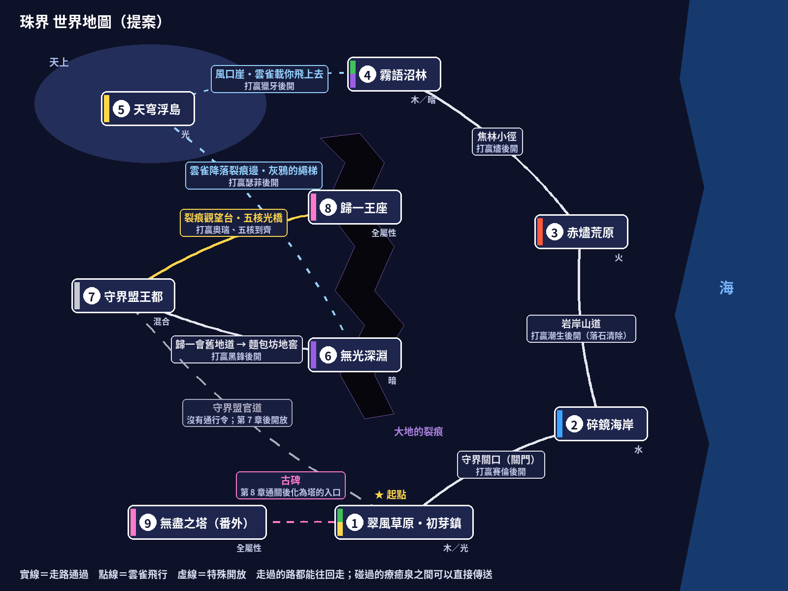
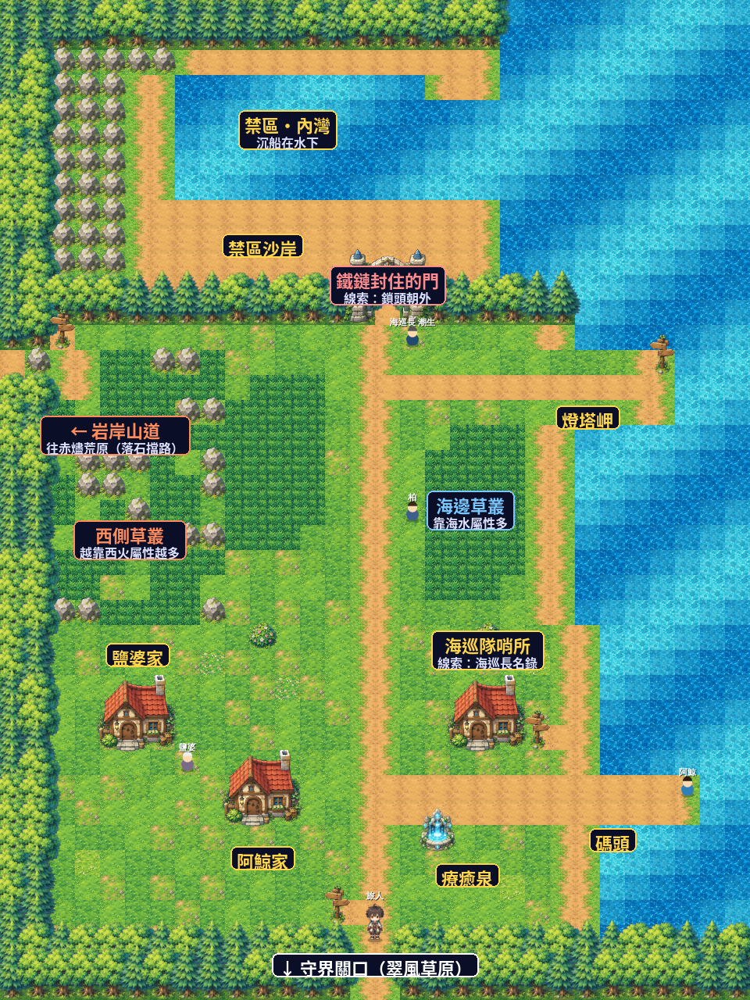

# 《珠界：歸一之子》遊戲規劃書（給接手開發者／其他 AI）

版本：v1.11（第 1～3 章可玩原型）｜劇情設定：`docs/STORY.md`（v1.11）｜語言：繁體中文｜平台：手機瀏覽器（直式）

---
## 0. 一句話
像寶可夢一樣在地圖上走路、草叢遇怪、收服怪物、挑戰地圖守衛；但戰鬥是神魔之塔式的「轉珠」。玩家是歸一會（史冊上的反派）的後代，追查守界盟與英雄史冊的矛盾，逐步拼出一場失敗的儀式與被修訂的歷史。

## 1. 設計支柱（不可違背）
1. **攻擊與收服要取捨。** 只有「與隊伍怪物同屬性」的珠子造成傷害；「符」珠只用來收服。正常消珠不應自動湊滿符。
2. **取捨不能用以下方式解決：** 沒有「留情／保證不死」模式；不能一直把敵人血量往上堆（玩家升級攻擊也升，會無止境）；不能單純加符珠或把需求降到無感。目前採「野生珠獸單回合承受傷害上限」＋可調參數。
3. **沒有商店。** 道具只靠探索、戰鬥掉落與劇情。**沒有徽章。**（故事用「史冊殘卷」取代）
4. 手機優先、虛擬搖桿、需要存檔、背包介面、怪物有 HP／攻擊／回復三圍。
5. 怪物不要全是三階進化：有三階、二階、不進化三種。
6. 角色與怪物圖由使用者用 ChatGPT 生成；開發者負責切圖、去背、整合。

## 2. 核心玩法
### 2.1 地圖探索
- 圖塊地圖（第 1 張 28×36、第 2 張 30×40、第 3 張 30×34），虛擬搖桿移動，角色有 4 方向走路動畫；草叢（高草）會遇怪，角色站在高草中下半身被草遮住（用同一張草貼圖蓋上，與底圖無縫）。
- 地圖有城鎮（療癒泉全隊回滿）、NPC、可調查物件（古碑）、地圖守衛（關口）。
- **共 9 章**【已定】：第 1～8 章是完整主線，各一張地圖、一位守衛；第 9 章是**番外篇**（主線通關後開放的無盡之塔與執筆者）。
- 目前：第 1 章（翠風草原）、第 2 章（碎鏡海岸）、第 3 章（赤燼荒原）可以完整遊玩。第 3 章包含焦痕、油桶印記、慰問名單、灰婆婆口述、阿杜的消息交易、燼守衛戰、火核碎片與小豆第三段歌謠（v1.11）。
- **世界地圖與連接（v1.5 提案）**：見 `docs/世界地圖_提案.png`。所有走過的通道都可以往回走。
- **療癒泉傳送（v1.6 已實作）**：每張地圖有一座療癒泉。碰過的療癒泉會記在 `P.springs`；之後在任何一座療癒泉都能選擇傳送到其他碰過的療癒泉（到達位置＝該地圖的 `home`）。所以第 6 章想回第 1 章，走到療癒泉就能直接回去。

  

| 從 | 到 | 通道 | 開放條件 |
|---|---|---|---|
| 1 翠風草原 | 2 碎鏡海岸 | 守界關口（關門，往北） | 打贏賽倫（已實作） |
| 2 碎鏡海岸 | 3 赤燼荒原 | 岩岸山道（海岸西側出口，落石擋路） | 打贏潮生 |
| 3 赤燼荒原 | 4 霧語沼林 | 焦林小徑 | 打贏燼 |
| 4 霧語沼林 | 5 天穹浮島 | 風口崖，雲雀載你飛上去 | 打贏獵牙 |
| 5 天穹浮島 | 6 無光深淵 | 雲雀降落在裂痕邊，灰鴉的繩梯下去 | 打贏瑟菲 |
| 6 無光深淵 | 7 守界盟王都 | 歸一會舊地道，出口是莉亞麵包坊的地窖 | 打贏黑鋒 |
| 7 守界盟王都 | 8 歸一王座 | 裂痕觀望台，五核光橋 | 打贏奧瑞、五核到齊 |
| 1 翠風草原 | 7 守界盟王都 | 守界盟官道（賽倫走的路） | 主角沒有通行令；第 7 章後開放當捷徑 |
| 1 翠風草原 | 9 無盡之塔 | 古碑 | 第 8 章通關後，古碑化為塔的入口 |

- 碎鏡海岸配置（見 `docs/碎鏡海岸_全圖提案.png`）：北＝禁區（內灣與沉船，鐵鏈門）｜西＝岩岸，岩岸山道往赤燼荒原｜中＝沙丘草叢｜東＝沙灘、海、燈塔岬｜南＝海岸漁村（鹽婆家、阿鯨家、海巡隊哨所、療癒泉、碼頭），往南回守界關口。地圖由 `tools/coast.py` 產生。

  

- **野生遇怪規則（v1.5）**：屬性由「這張地圖在世界上的位置」決定，不在每張地圖裡硬塞各種地形。
  1. 地圖本身的屬性（`encBase`）＋**越靠近哪一邊，就越多那一邊相鄰地圖的屬性**（`edges`）＋身邊有水時水屬性多一點。光、暗各至少 5%（`ENC_LD`）。
     例：碎鏡海岸西邊通往赤燼荒原，所以越往西火屬性越多；南邊通往翠風草原，所以靠南木屬性多一點。
  2. 12%（`ENC_HI`）出 ★3 以上：只出 roster 的 `zone` 有這一章的怪，且不超過該章 `starMax`；其他時候出 ★2，★2 各地都可能出現。
  3. 等級依第 2.6 節章節表。實測碎鏡海岸：東側海邊水屬性約 67%、沒有火屬性；西側火屬性約 41%。

### 2.2 轉珠戰鬥
- 盤面 6 欄×5 列；珠子：水0 火1 木2 光3 暗4 符5。拖曳珠子，路徑上依序交換，限時 6 秒；3 連以上消除，連鎖補珠，Combo 加成 +25%／combo。
- 傷害：每個消除群組，對隊伍中每隻同屬性怪物造成 `atk × (1+0.25×(群組大小−3)) × 屬性相剋`，再乘 `(1+0.25×(combo−1))`。
- 屬性相剋：水>火>木>水；光↔暗互剋（攻擊 ×1.5／被剋 ×0.5；受傷 ×1.25／×0.8）。
- **符**：整場戰鬥累計達「所需符數」就進行一次收服判定（成功則收服並結束；失敗則扣掉所需符數、繼續）。
- 收服率 = `CAPBASE[星數] × (1+(1−敵血比)×1.5) × clamp(1+(隊伍平均等級−敵等級)×0.06, .5, 1.5)`，限制 [0.03, 0.95]。`CAPBASE=[0,0,.6,.45,.3,.2,.12,.06]`。
- 敵方行動倒數（野生 3 回合、守衛 2～3 回合）歸零時攻擊隊伍；隊伍共用一條血（各隻最大 HP 相加）。
- **沒有自然回血**：回血只靠技能、療癒泉、道具（回復藥）。戰鬥後不回血。
- 野生珠獸：每回合最多承受 `最大血量 × TUNE.cap%` 傷害（多餘傷害浪費，逼玩家改消符）。守衛戰沒有符、沒有上限，對手整隊同時上場（見下方）。
- **對手多隻同時上場（v1.7 已實作）**：守衛（之後的小兵也一樣）的整隊一起上場，不再一隻打完才換下一隻（取代原本的「多波」）。野生戰仍是一隻（收服判定只對單一目標）。
  - 點對手的圖可以選攻擊目標（金框）。我方每一隻的每一下攻擊都打目前目標；目標倒下後，後面的攻擊自動換打下一隻；單一下攻擊打死目標後多出來的傷害不會延續。
  - 每隻對手各自倒數，開場第 i 隻多加 `FOE_CD_STAGGER`×i 讓牠們錯開；同一回合倒數到 0 的一起出手，共用同一次轉珠的 Combo。
  - 每隻的攻擊力乘 `FOE_TEAM_SCALE(上場隻數)`＝2÷(隻數＋1)，讓難度主要由等級與 Combo 決定（3 隻＝0.5、6 隻≈0.29）。
  - 第 1 章賽倫：聖光梟 Lv7、熾天使長・拉斐 Lv11、星尾獅 Lv9 同時上場。第 2 章柏（小兵）：鰭仔 Lv8、苔甲龜 Lv9；潮生：珊瑚龜 Lv12、滄海祭司・涅瑞 Lv16、飛鰭魚龍 Lv14。
  - 對人戰共用 `startTeamBattle`；守衛隊員／首領／小兵的血量與攻擊倍率在 `FOE_MUL`。
- **對手轉珠（v1.6 已實作）**：野生戰維持原樣。對人（守衛；之後的小兵也一樣）時，對手攻擊回合會在敵人區塊疊一個**對手自己的盤面**（跟玩家盤面分開算），演出轉珠：先消掉「排好的」Combo（數量依該章 `CHAPTERS[章].combo` 範圍隨機），補珠後若剛好又連成就是「天降」，繼續消、繼續加 Combo（最多連鎖 `FOE_SKYFALL_MAX` 輪）。
  - 傷害＝攻擊力 × 屬性相剋 × `FOE_COMBO_BASE` ×（1 + `FOE_COMBO_STEP` ×（Combo−1））。`FOE_COMBO_BASE=0.75` 讓第 1 章賽倫的平均傷害跟改之前差不多。
  - 各章守衛排好的 Combo：1【1–2】2【2–3】3【2–4】4【3–4】5【3–5】6【4–6】7【5–7】8【6–8】，再加天降。

### 2.3 可調平衡參數 `TUNE`（背包→系統頁可調，存 localStorage `orbrpg_tune2`）
| 參數 | 預設 | 意義 |
|---|---|---|
| cap | 9 | 野生單回合承受傷害上限（% 最大血量）|
| cw | 1.5 | 符珠出現權重（其他屬性 1.0；隊伍屬性 1.35）|
| need | 20 | 收服判定所需符數 |

模擬依據見第 9 節。**修改平衡前請先用 `tools/balance_sim.py` 重新測。**

### 2.4 技能系統（v1.1）
- 每隻怪戰鬥時只能裝備 **1 個主動技能**；每條進化線有 5 個技能，Lv **1/10/20/32/45** 學會，由「屬性傾向表 `FAMS` + 進化線名稱雜湊」確定性決定（同線進化後共用）。背包→隊伍/倉庫→「技能」可切換。
- **蓄力：消除該怪「自身屬性」的珠子累積能量**（不是回合冷卻）。需求顆數 = `round(冷卻值×1.5)`；收服輔助類（符咒／縮符／誘引）開戰蓄滿，其他類開戰 50%。滿了點戰鬥畫面隊伍頭像發動，**不消耗轉珠回合**。符珠不蓄力。
- 技能類型（共 22 個，定義在 `SKILLS`）：
  - 轉珠：符咒（N 顆屬性珠→符）、淨化（符→自身屬性）、染色（他屬性→自身屬性）
  - 傷害：衝擊／重擊／崩毀（ATK 倍率；野生戰最多打到剩 1 血）、吸取／噬魂（傷害轉體力）
  - 回復：療癒／祝福／生命之泉（依回復力浮動）
  - 控場：凍結（敵行動倒數 +N）、守護／聖壁（2 回合減傷）、激昂／狂熱（下一次消珠傷害 ×N，也提高野生傷害上限）
  - 收服：誘引／魅惑（收服率 +12%／+20%）、縮符／絕對束縛（所需符 −3／−5，最低 10；只對野生有效）

### 2.5 成長與進化
- 星級（稀有度）★2～★7；等級上限 60；`lvMul = 1+0.12×(Lv−1)`；升級經驗 `20+Lv²×3`；經驗倍率依星級。
- 三圍：`hp = 80×(r−1)^0.6×s0`、`atk = 16×(r−1)^0.6×s1`、`rec = 9×(r−1)^0.5×s2`，各隻有 0.9～1.1 個體值。
- 進化：三階線 Lv16→Lv32；二階線 Lv22；不進化者只有一階（見 `data/roster.json` 的 `next`／`evo`）。
- 隊伍最多 6 隻，其餘進倉庫；圖鑑記錄已見／已收服。

### 2.6 各章等級表（v1.5 提案；程式常數 `CHAPTERS`）
v1.4 的表太強，v1.5 下調：野怪明顯低於守衛，每章約升 5 級，主線結束約 Lv45，Lv60 留給番外的塔。經驗值公式不放寬（維持原本）。
| 章 | 地圖 | 野生 ★2 | 野生 ★3 以上 | 野生最高星 | 守衛隊伍（同時上場） | 約要打幾場野怪才到守衛等級 |
|---|---|---|---|---|---|---|
| 1 | 翠風草原 | 2–5 | 3–6 | ★3 | 7・9・11 | 17 |
| 2 | 碎鏡海岸 | 6–9 | 8–11 | ★4 | 12・14・16 | 38 |
| 3 | 赤燼荒原 | 11–14 | 13–16 | ★5 | 17・19・21 | 52 |
| 4 | 霧語沼林 | 16–19 | 18–21 | ★5 | 22・24・26 | 66 |
| 5 | 天穹浮島 | 21–24 | 23–26 | ★6 | 27・29・31 | 81 |
| 6 | 無光深淵 | 26–29 | 28–31 | ★6 | 32・34・36 | 95 |
| 7 | 守界盟王都 | 31–34 | 33–36 | ★7 | 37・39・41・43（四隻） | 110 |
| 8 | 歸一王座（回憶） | 36–39 | 38–41 | ★7 | 42・44・46 | 125 |
| 9 番外 | 無盡之塔 | — | — | — | 第 N 層約 Lv(40+N)，到 60 封頂後改加血量／攻擊倍率 | — |
- 「場數」只算打 ★2 野怪、隊伍只有一隻的情況；收服、打小兵、★3 以上的經驗都更多，實際會比較少。
- 小兵（盲信正派、私仇敵人、回憶中的士兵）：用該章野生 ★2 等級上限。

## 3. 劇情與世界觀

完整故事、角色弧、九章流程、殘卷矛盾、賽倫的信與四種結局，統一以 `docs/STORY.md` v1.10 為準。該文件將使用者已確認設定與本次整理提案分開標記；未標示為「已定」的補完內容不視為使用者定案。

- **故事核心：**主角「夜」是歸一會舊部的後代，帶著舊紋章吊墜。第 1～8 章逐步收集八卷殘卷，追查歸一前夜失敗的縫合儀式及後來遭修訂的史冊；第 9 章是主線通關後開放的無盡之塔番外。
- **主題界線：**官方史冊有刪改，但八卷證據也各有來源缺口。第 8 章的五核回聲是持有者記憶，不是客觀錄影；遊戲不提供可替玩家蓋棺論定的唯一答案。
- **章節結構：**每章安排環境、人物或文件線索，守衛戰是立場衝突的結果，不是取得調查資訊的唯一方式。勝利後交接殘卷、信物或珠核。
- **劇情鎖關模板：**線索 NPC → 場景調查點 → 見證者／資料 → 殘卷或信物 → 守衛接受挑戰。未完成時守衛無視玩家並提示下一步；旗標存在 `P.flags`。可選線索（如第 1 章歌謠 `song`）不阻擋主線。
- **角色延續：**小豆每章末唱下一段歌謠；賽倫第 1～6 章寄信，第 7 章本人協助夜。每封信和歌謠呈現角色當下理解，不替玩家解釋線索。
- **已確認限制：**老周是執筆者及史官後代，第 1～8 章不可暗示；第 9 章四結局為公開、公開並註明存疑、留白、燒毀所有殘卷，燒毀不設解鎖條件。
- **目前實作：**第 1 章老周（`q1`）→ 古碑（`stele`）→ 斗篷人（`truth1`）→ 賽倫守衛戰 → 殘卷壹（`guardDone`），關口開啟；小豆與第一段歌謠已加入。第 2 章完整可玩流程見本文件 2.1 及 CHANGELOG。第 3 章已接入，旗標與逐步目標記錄於存檔；第 4～9 章仍屬規劃，不能把故事文件中的提案描述為已實作。
## 4. 介面
- 畫面：標題（新遊戲／繼續）→ 序章對話（含立繪頭像）→ 選御三家（泡泡獺 水／火苗蜥 火／嫩芽鹿 木，皆 ★2）→ 地圖 → 戰鬥／背包。
- 背包分頁：隊伍、倉庫、圖鑑、道具、殘卷（含「目前目標」提示）、系統（存檔、匯出入存檔碼、平衡參數調整、清除）。
- 對話框：打字顯示、點擊繼續、可帶立繪頭像。

## 5. 存檔
- `localStorage` 鍵 `orbrpg_save_v3`（格式變更時請升版號）；亦可匯出／匯入 base64 存檔碼。
- 玩家 `P`：`{v:1,name,map,springs:[],x,y,team:[],box:[],dex:{id:1|2},items:{potion,candy},flags:{},scrolls:[],hpFrac,uid}`；怪物實例：`{id,lv,exp,iv:{hp,atk,rec},uid,sk?}`。
- `P.map`＝目前地圖代號（v1.3 新增；舊存檔沒有這欄時視為 `grass`，所以沒有升存檔版號）。
- 目前旗標：第 1 章 `intro, q1, stele, truth1, cloakGift, guardDone, song`；第 2 章 `c2_jing → c2_chain → c2_box → c2_bo → c2_roster → c2_dive → c2_done`、`song2`；第 3 章 `c3_moen → c3_burn → c3_oil → c3_list → c3_testimony → c3_review → c3_done`、`c3_song` 與 `fireFragment`。
- `P.cores`＝取得的珠核（0 水 1 火 2 木 3 光 4 暗）；`P.letters`＝收過的賽倫的信（`LETTERS` 的編號）。

## 6. 美術規格與流程
- **出圖指令**：`docs/ART_PROMPTS.md`（給人看的版本：pokemo 根目錄 `美術出圖指令.html`，每段有複製按鈕），由 `tools/art_prompts.py` 產生。使用者出好的原圖放在 `art_in/`，檔名照指令表；畫風參考圖是 `art_in/_參考圖_第1章.png`。
- **處理流程（v1.9）**：`python3 tools/art_process.py` 會處理 `art_in/` 裡所有照規則命名的原圖：地磚自動找格線切成 512×512、物件照 3×3 切格各取主體、站姿切成 4 格（正、背、左、右）、立繪縮到 240 高、首領貼進 `assets/ui/bosses.webp` 對應格。`build.py` 會把 `assets/chars`、`assets/art` 裡的圖自動對應模板裡的 `__C_名稱__`／`__P_名稱__`／`__A_名稱__`。
- 已接上的圖：第 1 章小豆（站姿＋立繪）、新的熾天使長・拉斐；第 2 章全部（海岸地磚、9 個物件、潮生／阿鯨／鹽婆／柏的站姿與立繪、滄海祭司・涅瑞、海岸戰鬥背景）。
- 站姿側面：`art_process.py` 會看臉（膚色）在頭的哪一側判斷朝向，自動排成「朝左、朝右」；ChatGPT 常把兩個側面畫成同一邊，這時會用鏡像補另一邊。
- 地圖可設定 `battleBg`（該地圖所有戰鬥用的背景，例：海岸 `coast`）。
- 地圖可以覆寫地磚用法：`ground`（地面隨機挑的格）、`water`／`waterAlpha`（兩格水的疊法與閃動幅度）、`props`（某格改畫某個物件）。
- 地磚圖集 16 格的位置固定（程式依位置讀），各章只換材質；物件 9 格固定順序：樹 1、樹 2、房屋、療癒泉、告示牌、關門、岩石、灌木、該章特殊物件。
流程：使用者用 ChatGPT 出圖（洋紅 #FF00FF 去背底）→ `tools/` 腳本切圖去背 → 放入 `assets/` → `python3 build.py`。
| 類別 | 規格 | 位置 |
|---|---|---|
| 怪物 | 每屬性 1 張，6 欄×4 列＝24 格；腳本重排成每格 192px，webp | `assets/monsters/{water,fire,wood,light,dark}.webp`；出圖提示詞：`docs/怪物出圖指南.md` |
| 角色（走路） | 4 方向×3 格（下、左、右、上 × 左腳/站/右腳），格 120×202；播放順序 站→左→站→右 | `assets/chars/main.webp`；NPC 目前仍是 4 格站姿（正、背、左、右，約 94～116×202）|
| 頭像 | 對話用 | `assets/chars/*_p.webp` |
| 地圖 | 4×4 地磚圖集 512×512（每格 128，含草、路、路緣、高草[3,0]、水、花等）；立體物件（樹、房、噴泉、牌、關門、石、灌木）| `assets/art/` |
| 珠子 | 960×160（6 顆）；戰鬥背景／守衛圖 | `assets/ui/` |
- 每張新地圖需要：一張地磚圖集＋一組立體物件圖＋（可選）新 NPC／守衛站姿或走路圖。
- 著作權：禁止直接複製現有作品；怪物與角色須為原創設計。

## 7. 程式結構（`src/template.html`，約 1200 行）
單檔 HTML/CSS/JS；圖片以 `__XXX__` 佔位，由 `build.py` 轉 base64 內嵌，輸出 `dist/index.html`。
| 區塊 | 關鍵函式／常數 |
|---|---|
| 常數與資料 | `ATTR, RAR, TUNE, SP(怪物表), ROSTER, CAPBASE, STARTERS, CHAPTERS(各章等級), ENC_*(遇怪規則)` |
| 數值 | `st(m), newMon, lvMul, expNeed, addExp(升級/進化/學技能)` |
| 技能 | `SKILLS, SKF, FAMS, skillList, skillOf, skCost, useSkill` |
| 存檔 | `freshPlayer, save, loadSave, exportCode, importCode` |
| 地圖 | `MAPS, loadMap, changeMap, buildMapData, refreshMap, buildGrass, T 圖塊型別, drawTile/drawArt/drawMap, coverGrass, update(移動碰撞/遇怪/傳送)` |
| 劇情 | `SCROLLS（含 src 來源、flaw 矛盾欄位）, questHint, interactNpc, interactTile, guardEvent, afterGuardWin` |
| 戰鬥 | `beginBattle, mkEnemy, encWeights, encPool, pickWild, weightsFor, findGroups, resolveBoard, afterMove(核心結算), calcDamage, capChance, onCapture, endBattle` |
| 介面 | `say(對話), modal, renderBag, renderBattle` |
- **地圖資料化（v1.3）**：每張地圖是 `MAPS` 裡的一筆資料，欄位說明寫在程式 `MAPS` 上方註解。重點：
  - 圖塊：`build()`（程式產生，第 1 章用）或 `rows`（ASCII 字串，一個字元一格，對照表 `TCH`：`#`樹 `.`草 `,`高草 `~`水 `=`路／沙 `F`療癒泉 `*`花 `G`關門 `S`告示牌 `b`灌木 `r`石頭）。房屋另用 `houses` 放。
  - `npcs`（`hideIf`：某旗標成立時消失；`talk`：自訂對話函式）、`ch` 章節（決定等級，見 `CHAPTERS`）、`encBase` 水火木基本權重、`encRate`。
  - `warps` 傳送點（`need`：需要的旗標）、`state(m,flags)` 依劇情改圖塊、`signs` 告示牌文字、`onTile` 特殊圖塊對話、`home`／`homeName` 戰敗送回位置。
  - `art`：地圖專屬素材對照，例如之後拿到海岸地磚就寫 `art:{tiles:'tiles_coast'}`，並在 `build.py` 的 `AM` 與程式 `ART` 載入清單加上該圖。
  - 換地圖：`changeMap(代號,x,y,面向)`；目前地圖狀態在 `CURID / CUR / map / MW / MH / NPCS`。
  - 守衛戰勝利後要做的事用 `beginBattle({...,onWin})` 傳入（第 1 章是 `afterGuardWin`）。
- 守衛戰用 `startGuardBattle`（`mkEnemy` 多波，最後為 `boss_*`）。

## 8. 資料檔
- `data/roster.json`：110 隻怪。欄位：`id, name, attr(0-4), rar(2-7), line(進化線), pattern(c3|c2|c1), stage, head(是否可野生遇到的第一階), row, col(在屬性圖集的格位), zone[], next, evo, st[hp,atk,rec 基礎係數], desc(英文外觀描述，出圖用)`。
- `docs/STORY.md`：劇情設定集（v1.10；本版正本取代舊 PDF 的 v1.8 內容）。`docs/碎鏡海岸_全圖提案.png`：第 2 章全圖。`docs/世界地圖_提案.png`：世界地圖（`tools/world_map.py` 產生）。
- 技能、劇情目前直接寫在 `template.html`；建議之後抽成 `data/skills.json`、`data/story/*.json`。

## 9. 平衡與模擬
- `tools/balance_sim.py`、`tools/balance_grid.py`：Python 模擬器（機器人每回合在 N 條隨機拖曳路徑中挑最佳，政策：只打傷害／兼顧／全力消符；隊伍 1/2/3 隻）。
- 目前預設 `cap 9 / cw 1.5 / need 20` 的模擬結果（觸發＝累積符達標一次）：只打傷害 0.3/0.3/0.1 次；兼顧 0.9/0.7/0.5 次；全力消符 0.9～1.3 次（1/2/3 隻怪）。舊值（12/1.0/30）下，全力消符單隻怪也只有 0.17 次、兩隻 0 次，使用者回報「一隻怪很難觸發第二次捕捉、兩隻怪很難觸發一次」。
- 模擬對人類偏樂觀；請以實際試玩回饋修正，且不要破壞「只打傷害 ≈ 抓不到」。

## 10. 測試
- `tests/test*.py`：Playwright（Chromium 手機視窗 390×780）。`test18.py`＝多隻對手同時上場；`test19.py`＝第 2 章從頭玩到尾。例如 `test15.py`（22 個技能全測）、`test16.py`（劇情鎖關流程）、`test17.py`（多地圖：舊存檔相容、關門往返海岸、依地形的遇怪分布與等級、戰敗送回、小豆歌謠；可傳入舊版 dist 路徑比對第 1 張地圖）。需先 `python3 build.py`；截圖存在 `tests/shots/`。

## 11. 待辦清單（建議順序）
1. ~~地圖資料化＋多地圖切換、各區遇怪表。~~（v1.3 完成）
2. 第 2 章（碎鏡海岸）：主線、守衛戰、殘卷貳、水核、賽倫第 1・2 封信、小豆第 2 段歌謠，以及地磚、物件、主要角色和戰鬥背景均已接入（v1.10）。
2b. ~~第 3 章（赤燼荒原）：荒原地圖、調查流程、NPC、燼的守衛戰、殘卷參、火核碎片、賽倫第三封信與小豆歌謠已接入（v1.11）。~~
3. 第 4～8 章故事流程已在 STORY.md 完整規劃；仍待地圖、事件與對話、守衛戰、殘卷肆～捌實作。
4. 第 9 章番外已在 STORY.md 完整規劃；仍待無盡之塔樓層、Boss、獎勵、執筆者戰與四種結局實作。
4b. 對手轉珠的平衡：依試玩調整 `CHAPTERS[].combo` 與 `FOE_COMBO_*`。
5. NPC／守衛走路圖；守衛新原創 Boss 圖（目前沿用舊作 Boss 圖）。
6. 技能／劇情資料抽成 JSON；音效與音樂（目前無）。
7. 平衡：依試玩調整 `TUNE`、技能蓄力倍率（目前 ×1.5）、技能數值。
8. 其他：道具擴充（無商店）、成就、更多怪物（目標 100+，現 110 隻）。

